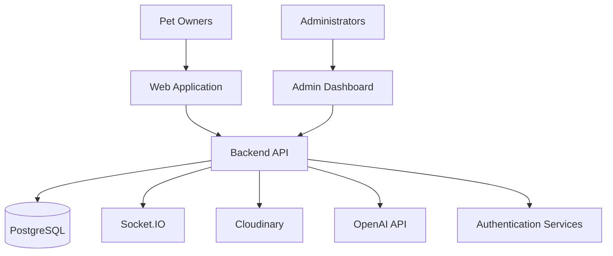

# ALEEF 🐾
### A Smarter Way to Care for Your Pets

**ALEEF** is an integrated pet-care platform designed to make pet ownership easier by bringing veterinary services, pet health management, and pet supplies together in one place.

From booking veterinary appointments to managing medical records and shopping for pet essentials, ALEEF aims to simplify the entire pet-care experience through a connected digital ecosystem.

This repository brings together the **web application, administration dashboard, and backend API** into a single codebase.

---

## 📌 Table of Contents

- [Overview](#-overview)
- [Key Features](#-key-features)
- [Applications](#-applications)
- [Tech Stack](#-tech-stack)
- [System Architecture](#-system-architecture)
- [Project Structure](#-project-structure)
- [Getting Started](#-getting-started)
- [Environment Variables](#-environment-variables)
- [API & Security](#-api--security)
- [Future Improvements](#-future-improvements)
- [Contributors](#-contributors)

---

## 🌟 Overview

Pet owners often rely on multiple disconnected services to find veterinarians, schedule appointments, track vaccinations, and purchase essential supplies.

ALEEF brings these experiences together in a unified platform built around the needs of pet owners, veterinarians, and administrators.

The platform consists of three main components:

- **Web Application:** The user-facing experience for accessing pet-care services.
- **Admin Dashboard:** A centralized interface for managing platform operations and monitoring key resources.
- **Backend API:** The core service responsible for business logic, authentication, data management, appointments, orders, and real-time communication.

The goal is to build a scalable, maintainable, and user-friendly ecosystem that makes pet care more accessible and organized.

## ✨ Key Features

### 🐶 Pet Management
- Manage pet profiles and essential information.
- Maintain pet medical and vaccination records.
- Keep important pet-care information organized in one place.

### 🩺 Veterinary Services
- Discover available veterinarians.
- Book and manage veterinary appointments.
- Support appointment status workflows, including pending, accepted, rejected, completed, and cancelled appointments.
- Manage veterinary schedules and appointment availability.

### 🛍️ Pet Supplies Marketplace
- Browse pet products and supplies.
- Manage shopping carts and place orders.
- Support product inventory and stock-aware checkout.
- Manage orders and product information through the administrative dashboard.

### 💬 Real-Time Communication
- Real-time messaging powered by Socket.IO.
- Communication features designed to support interaction within the platform.

### 🤖 AI-Powered Assistance
- AI chatbot integration to help users access pet-care information and assistance.

### 🔐 Authentication & Authorization
- JWT-based authentication.
- Role-based access control (RBAC).
- Google OAuth integration.
- Email verification and account-related security workflows.

### 🛠️ Administration Dashboard
- Manage users and veterinarian accounts.
- Manage products and orders.
- Monitor and manage appointments.
- Perform administrative actions, including account restrictions.

---

## 🧩 Applications

| Component | Description |
|---|---|
| Web Application | The user-facing interface for pet-care services |
| Admin Dashboard | Administrative tools for managing platform resources |
| Backend API | Business logic, authentication, database operations, and integrations |

Each component has a separate responsibility while working together as part of the same platform.

## 🧰 Tech Stack

### Backend
- Node.js
- TypeScript
- Express.js
- PostgreSQL
- Socket.IO
- JWT Authentication
- Google OAuth
- Cloudinary
- OpenAI API

### Admin Dashboard
- React
- TypeScript
- REST API Integration

### Web Application
- Frontend technologies and libraries used by the web client

> Update this section with the exact framework, styling solution, and other libraries used by the web application.

### Infrastructure & Tools
- Git & GitHub
- Environment-based configuration
- PostgreSQL connection pooling
- Caching for frequently accessed data
- Cloud-based media storage

---

## 🏗️ System Architecture

ALEEF follows a modular client-server architecture in which the frontend applications communicate with a shared backend API.



### Architecture Highlights

- **Separation of concerns:** Frontend applications and backend business logic are maintained independently.
- **Centralized API:** Applications share backend services instead of duplicating business logic.
- **Relational data management:** PostgreSQL stores the platform's structured data.
- **Real-time capabilities:** Socket.IO supports real-time communication.
- **External integrations:** Cloudinary and OpenAI provide media management and AI capabilities.

---

## 📁 Project Structure

The repository is organized as a monorepo containing the main applications and services.

```text
ALEEF/
├── web/              # User-facing web application
├── dashboard/        # Admin dashboard
├── backend/           # Node.js / Express API
├── README.md
└── .gitignore
```

> The directory names above are illustrative. Adjust them to match the actual repository structure.

---

## 🚀 Getting Started

### Prerequisites

Make sure you have the following installed:

- Node.js (compatible with the project dependencies)
- npm
- PostgreSQL
- Git

Additional services or API credentials may be required depending on the integrations you enable.

### 1. Clone the Repository

```bash
git clone <YOUR_REPOSITORY_URL>
cd ALEEF
```

### 2. Install Dependencies

Install dependencies separately for each application, according to its package manager and project configuration.

```bash
cd backend
npm install
```

Repeat for the web application and dashboard directories.

### 3. Configure Environment Variables

Create the required `.env` files based on each application's configuration and the environment variables documented below.

Never commit real credentials or production secrets.

### 4. Set Up the Database

Configure your PostgreSQL connection and ensure the required database schema is initialized using the project's existing migration or database setup process.

### 5. Run the Applications

Start each component using the scripts defined in its respective `package.json`.

For example, if the backend defines a development script:

```bash
cd backend
npm run dev
```

Follow the individual application's configuration for running the web client and dashboard.

---

## 🔑 Environment Variables

The following table describes common configuration values that may be required. Exact variable names depend on the implementation.

| Variable | Purpose |
|---|---|
| `PORT` | Backend server port |
| `DATABASE_URL` | PostgreSQL connection string |
| `JWT_SECRET` | JWT signing secret |
| `GOOGLE_CLIENT_ID` | Google OAuth client identifier |
| `GOOGLE_CLIENT_SECRET` | Google OAuth client secret |
| `CLOUDINARY_CLOUD_NAME` | Cloudinary cloud name |
| `CLOUDINARY_API_KEY` | Cloudinary API key |
| `CLOUDINARY_API_SECRET` | Cloudinary API secret |
| `OPENAI_API_KEY` | OpenAI API key |
| `CLIENT_URL` | Frontend origin used by the backend |
| `REDIS_URL` | Optional Redis connection, if configured |

**Important:** These are reference names, not a guarantee of the exact environment variables used in this repository. Check the source code and configuration files before setting them.

---

## 🔒 API & Security

The backend provides a centralized layer for application services and data access.

Key security and backend considerations include:

- Token-based authentication and protected routes.
- Role-based authorization for restricted operations.
- Secure handling of credentials through environment variables.
- Request validation and consistent error handling.
- Controlled access to uploaded media and external services.
- Database connection management and stock-safe order processing.

For API documentation, add a link to your API reference or provide an exported Postman collection if available.

**API Documentation:** `Add your API documentation link here`

---

## 🔮 Future Improvements

Potential areas for further development include:

- Expanded pet health tracking and reminders.
- Enhanced veterinary discovery and location-based search.
- Improved real-time notifications.
- More comprehensive automated testing.
- Performance monitoring and production observability.
- Additional deployment automation and scalability improvements.

---

## 👥 Contributors

ALEEF was developed as a collaborative project, with team members contributing to different parts of the platform.

**Team Leader & Backend / Dashboard Developer**

**Mahmoud Tamer**

- GitHub: [@mahmoudtamer0](https://github.com/mahmoudtamer0)
- LinkedIn: [mahmoudtamer0](https://www.linkedin.com/in/mahmoudtamer0/)

Add the remaining team members and their contributions here.

---

## 📄 License

Add the appropriate license for this project. If the repository is not intended for open-source reuse, clarify the applicable usage and distribution terms.

---

**Built with care for pets and the people who love them. 🐾**

*ALEEF — Better care, one paw at a time.*
