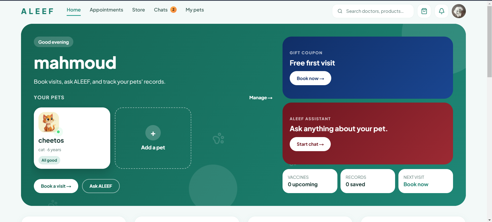
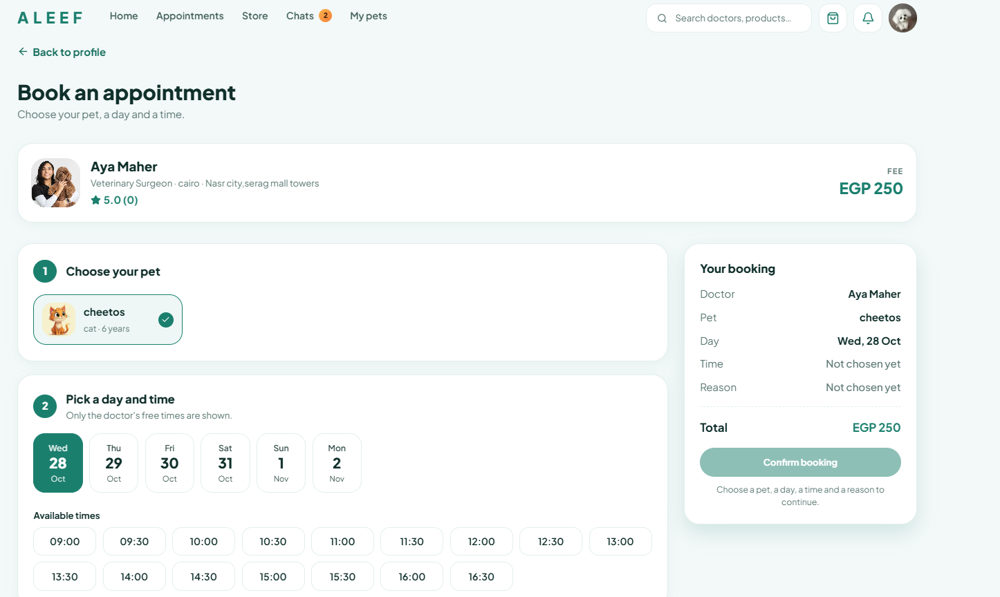
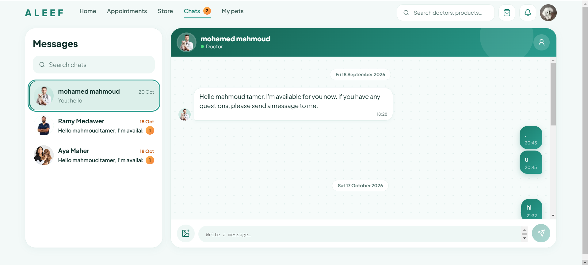
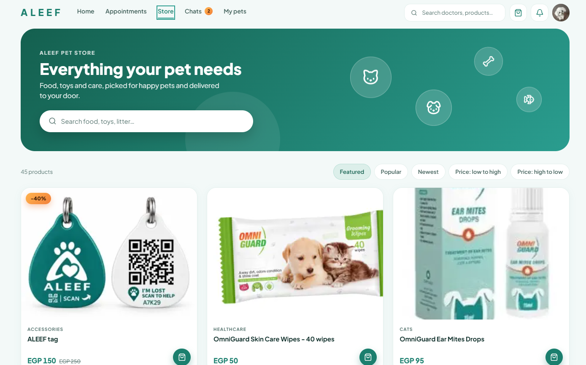
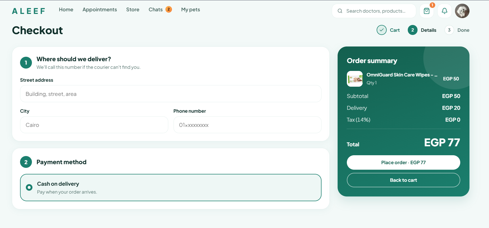
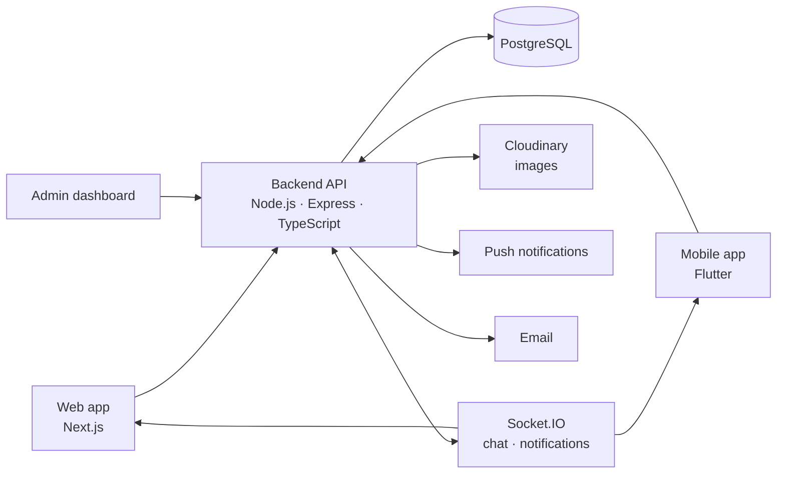

# ALEEF

> A pet-care platform: find a vet near you, book an appointment, chat with your doctor, and shop for your pet. Web app, admin dashboard, REST + real-time backend, and a Flutter mobile app.

<!-- TODO: put a wide screenshot or a short GIF of the web home page here -->


**Live demo:** <https://aleef-web.vercel.app/> — you are signed in automatically with a demo account (nothing to register).
**Admin dashboard demo:** <https://aleef-dashboard.vercel.app/>

---

## What you can do

**Pet owners (web + mobile)**
- Manage pet profiles (photo, type, birth date, records).
- Find vets by name, city or specialty, sorted by rating, price or **distance from you**.
- Book a visit: pick a pet, a day and a free time slot, add a reason and notes.
- Follow and cancel appointments; get a **real-time notification** when a doctor accepts.
- **Chat with the doctor** (text and photos) once the appointment is accepted.
- Shop for pet products: search, sort, cart, checkout, order tracking.

**Admins (dashboard)**
- Users, doctors and doctor sign-up requests.
- Appointments, products, orders (update the status), chats.
- Revenue and appointment charts.

<!-- TODO: add or remove items so they match what is really built. Doctors: describe what they can do and where. -->

## Screenshots

| Home | Booking | Chat |
|---|---|---|
|  |  |  |

| Store | Orders | Dashboard |
|---|---|---|
|  |  |  |

## Architecture




## Tech stack

| Part | Stack |
|---|---|
| `web/` | Next.js (App Router), TypeScript, CSS Modules, TanStack Query, Socket.IO client |
| `dashboard/` | TODO (e.g. React, TypeScript, ...) |
| `backend/` | Node.js, Express, TypeScript, PostgreSQL (`pg`), Socket.IO, TODO (auth, uploads, email, push) |
| Mobile | Flutter (separate repo) |

## Repository layout

```
aleef/
├── backend/     REST API + Socket.IO server        → backend/README.md
├── web/         Website for pet owners             → web/README.md
├── dashboard/   Admin dashboard                    → dashboard/README.md
└── docs/        Screenshots
```

## Run it locally

**Fastest way to look around (no backend, no database):** the web app has a mock mode with fake data.

```bash
cd web
npm install
cp .env.example .env.local     # NEXT_PUBLIC_USE_MOCK=true is already set
npm run dev                    # http://localhost:3000
```

**The full stack** (you need Node.js 20+ and PostgreSQL 15+):

1. **Database + backend:** follow [`backend/README.md`](backend/README.md) (it covers the schema and demo data).
2. **Web:** in `web/`, set `NEXT_PUBLIC_USE_MOCK=false` and `NEXT_PUBLIC_API_URL` in `.env.local`, then `npm run dev`.
3. **Dashboard:** follow [`dashboard/README.md`](dashboard/README.md).

## Engineering highlights

Things I'm proud of, and where to find them:

- **Safe checkout.** An order runs in one database transaction, and stock is taken with `UPDATE ... WHERE stock >= qty`, so two buyers can never oversell the last item. If anything fails, everything rolls back. → `backend/` orders service
- **Real-time chat and notifications.** Socket.IO rooms per user and per chat, unread counters, and the web app turns socket events into cache updates (no polling). → `backend/` chat sockets, `web/src/context/SocketContext.tsx`
- **Nearest doctors.** The Haversine distance is computed in SQL and combined with rating or price sorting, with pagination. The web app loads pages with infinite scroll. → `backend/` doctors service
- **Caching with invalidation.** Hot reads are cached and cleared whenever the data changes (for example when an appointment is accepted or cancelled).
- **Cancel with consequences.** Cancelling an appointment is a transaction: it updates the status, closes the chat, clears the caches and notifies the doctor.
- **Demo mode for reviewers.** Visitors are signed in with a restricted demo account, with a banner to create a real one.


## Author

**Mahmoud Tamer** — Full-stack developer.
[GitHub](https://github.com/mahmoudtamer0) · [Portfolio](https://mahmoud-tamer-portfolio.vercel.app) · [LinkedIn]: https://www.linkedin.com/in/mahmoudtamer0/ · Email: mahmoud.tamer.developer@gmail.com
