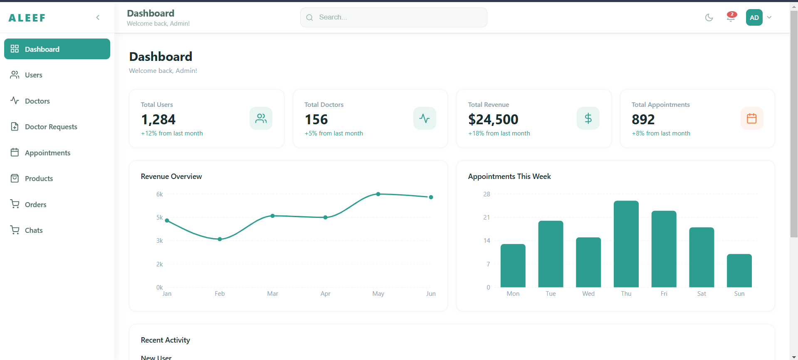

# ALEEF Dashboard

The admin dashboard for ALEEF.

Part of the [ALEEF monorepo](../README.md). It talks to [`../backend`](../backend/README.md).

<!-- TODO: screenshot -->


## Features

- Overview: total users, doctors, revenue and appointments, with charts
- Users and doctors
- Doctor sign-up requests (review them)
- Appointments
- Products and orders (see the details and change an order's status)
- Chats
- Light and dark mode, global search

<!-- TODO: add or remove items so they match what is built. -->

## Stack

TODO (for example: React · TypeScript · Vite · React Router · a chart library · ...)

## Quick start

Requires Node.js 20+ and a running backend (see [`../backend/README.md`](../backend/README.md)).

```bash
npm install
cp .env.example .env
npm run dev
```

## Environment variables

| Variable | Description |
|---|---|
| `TODO_API_URL` | Backend base URL, e.g. `http://localhost:5000/api` |

## Sign in

Use an **admin** account. With the demo data from `backend/database/seed.sql`:

| Email | Password |
|---|---|
| `TODO` | `TODO` |

## Scripts

| Command | What it does |
|---|---|
| `npm run dev` | Development server |
| `npm run build` | Production build |
| `npm run preview` | Preview the production build |

TODO: match these to your `package.json`.
